# Astra app — how it works

The living picture of the Expo app: every screen, what the user can do on it, and the path data
takes. Every commit that adds or changes a screen, user action, module or data path updates this
file in the same commit. It draws what exists in code today; scaffolding (placeholder screens,
services not yet wired) is marked so nobody mistakes a mock-up for a working feature.

Legend: solid boxes are working features; dashed boxes are placeholder screens whose layout is
final but whose actions do nothing yet; the dotted link is a connection that does not exist yet.

```mermaid
flowchart TD
  classDef scaffold stroke-dasharray: 5 5
  classDef data fill:#eef,stroke:#669

  Launch([App launch]) --> Root["Root layout<br/>loads brand fonts, wraps app in AuthProvider,<br/>holds splash until fonts AND saved session are ready"]
  Root --> Restore{"AuthProvider restore<br/>getSession(): local read of the saved session<br/>(no network; failure = signed out)"}
  Restore -->|session found| Tabs
  Restore -->|no session| SignIn

  subgraph AuthGroup["(auth) group: only reachable while signed out"]
    SignIn["Sign in<br/>email + password; friendly errors;<br/>shows 'check your email' notice if handed one"]
    SignUp["Sign up<br/>email, password, birthdate (MM / DD / YYYY)<br/>states Astra is 18+"]
    Gate{"18+ age gate (auth/age.ts)<br/>invalid or under 18?"}
    SignIn -->|Create an account| SignUp
    SignUp -->|I already have an account| SignIn
    SignUp -->|Create account| Gate
    Gate -->|yes: refuse on screen,<br/>nothing sent| SignUp
  end

  Tabs["Tab layout (only with a session)<br/>five bottom tabs, Workout dead center,<br/>floating top-right profile button"]

  Tabs --> Home["Home<br/>social feed (SOC-1)<br/>today: brand + empty state pointing to Workout"]
  Tabs --> Market["Marketplace<br/>programs (MKT-1..5)<br/>today: featured-section skeleton, placeholder cards"]
  Tabs --> Workout["Workout tab (on focus: re-read astra.db)<br/>no draft: Start empty workout (program start disabled, B35)<br/>draft on phone: Resume workout / Discard (asks first)<br/>Tool Kit tiles (placeholders, TK-1..5)<br/>Past workouts: newest 100 finished, date + duration + counts"]
  Tabs --> Communities["Communities<br/>Teams and Gyms<br/>today: two sections, each an empty state"]
  Tabs --> Library["Library<br/>browse every launch exercise as a card"]
  Tabs -->|profile button| You["You<br/>signed-in email + Sign out button<br/>profile skeleton: avatar ring, follow counts, PRs label (empty values)"]

  Library -->|type a name| Search["Live name search<br/>alias-aware, e.g. Squats finds Back Squat"]
  Library -->|tap a chip| Filter["Body-region filter chips<br/>four regions + result count + no-results state"]

  subgraph LibData["Exercise library data (frontend/src/library)"]
    Seed[("exercises.ts<br/>founder's library by movement pattern:<br/>22 patterns, equipment, muscle intensities,<br/>5-step coaching cues, name aliases")]
    Catalog[("catalog.ts<br/>one entry per unique exercise (151),<br/>canonical names, searchExercises")]
    Seed --> Catalog
  end
  Catalog --> Library
  Catalog --> Search
  Catalog --> Filter

  subgraph Device["On the device"]
    Store[("expo-sqlite key-value store<br/>the saved Supabase session<br/>(survives killing the app)")]
    LocalDB[("astra.db: on-device SQLite (src/db)<br/>exercises, workouts, workout_exercises, sets<br/>+ outbox (unsent changes) + sync_state (bookmarks)<br/>WAL; every write is one transaction")]
    LocalSeed["First-launch seed (library/seedLocal.ts)<br/>insert-if-missing all 151 exercises,<br/>id = uuidv5(namespace, slug); never queued"]
    WriteLocal["writeLocal / writeLocalTree (db/dao.ts): the queued write paths<br/>rows + outbox lines + re-stamp & queue parent workout,<br/>all-or-nothing (writeLocalTree: a whole workout in one transaction)"]
    Drafts["writeDraftRows / deleteDraftRowsTx (db/dao.ts): the in-progress path<br/>saved at once, NEVER queued; refused for a finished workout"]
    LocalSeed --> LocalDB
    WriteLocal --> LocalDB
    Drafts --> LocalDB
  end

  subgraph LoggerUI["Logger screens (signed-in stack, above the tab bar)"]
    Logger["Active workout (app/active-workout.tsx)<br/>EntryCard per exercise: sets, reps + weight in lb (displayUnit.ts),<br/>Log set, Repeat last set (ONE tap, NFR-2), remove set,<br/>move up / down, remove exercise, 'Last time' line (LOG-5)<br/>one store call per card at a time<br/>empty slot on open: resume from astra.db or go back"]
    Picker["Add exercise panel (ExercisePicker, a Modal)<br/>alias-aware searchExercises over the catalog;<br/>slug → libraryExerciseId → store.addExercise"]
    EmptyQ{"Finish with zero sets?"}
    Saved["Saved workout (app/workout/[id].tsx), read-only<br/>date, duration, every exercise + set in lb<br/>(another user's / unfinished id: 'not on this phone')"]
    Logger -->|Add exercise| Picker
    Picker -->|tap an exercise| Logger
    Logger -->|Finish| EmptyQ
    EmptyQ -->|"yes: 'Nothing logged yet'<br/>Discard workout / Keep lifting"| Logger
    EmptyQ -->|"no: finish, clear slot,<br/>router.replace"| Saved
  end
  Workout -->|"Start / Resume: store into the session slot<br/>(activeWorkoutSession.ts, keyed by user id)"| Logger
  Workout -->|tap a past workout| Saved
  Logger -->|"Discard (asks first) / back"| Workout

  subgraph Reads["History read-model (src/workout/history.ts), read only, every query filtered by user_id"]
    ListQ["listPastWorkouts: finished only, newest first, limit 100, counts"]
    ReadQ["readWorkout: one finished workout, entries joined to exercise names, sets"]
    LastQ["lastSessionSets: newest finished workout with a logged set of<br/>this exercise, never the current draft; + exerciseName"]
  end
  LocalDB --> ListQ --> Workout
  LocalDB --> ReadQ --> Saved
  LocalDB --> LastQ --> Logger

  subgraph ActiveWO["Active-workout store (src/workout/activeWorkout.ts)<br/>driven by the logger screens through the session slot + useActiveWorkout hooks"]
    StartWO["startActiveWorkout: blank public workout<br/>(refused while one is in progress)"]
    ResumeWO["loadActiveWorkout: on launch, rebuild the<br/>signed-in user's unfinished workout from astra.db"]
    MutWO["add / remove / reorder exercise; log / fix / remove set;<br/>repeat last set: check server limits, convert lb→kg,<br/>commit to SQLite, then re-read the snapshot"]
    FinishWO["finish: ended_at = max(now, started_at),<br/>queue workout + entries + sets in ONE transaction; store sealed"]
    DiscardWO["discard: delete the draft (cascades), nothing to sync"]
  end
  StartWO --> Drafts
  MutWO --> Drafts
  DiscardWO --> Drafts
  LocalDB --> ResumeWO
  FinishWO --> WriteLocal
  Workout --> StartWO
  Workout --> ResumeWO
  Logger --> MutWO
  Logger --> FinishWO
  Logger --> DiscardWO

  subgraph SyncEng["Sync engine (src/sync), mounted by useSync in the root layout"]
    Triggers{{"Triggers, debounced 750 ms, one run at a time:<br/>start with a session, app back to foreground,<br/>network reconnects, a local write"}}
    Push["Push: outbox → server, parents first,<br/>batches of 500 upserts on id (no updated_at),<br/>then workouts again to re-touch roots;<br/>clear lines up to each row's watermark; stop on failure"]
    Pull["Pull: exercises, then own workouts by (updated_at, id)<br/>bookmark minus 5 s; fetch their entries and sets;<br/>save page + bookmark in one transaction;<br/>skip rows with unsent local edits"]
    Triggers --> Push --> Pull
  end
  Catalog --> LocalSeed
  Root -->|"useSync: opens astra.db (seeds) always;<br/>engine only while signed in"| LocalDB
  Root --> Triggers
  LocalDB -->|outbox rows| Push
  Pull -->|saved rows| LocalDB
  WriteLocal -.->|"notifies"| Triggers

  subgraph Backend["Supabase project (live)"]
    AuthAPI["Supabase Auth<br/>email + password accounts"]
    Trigger{"signup trigger handle_new_user<br/>refuses missing / under-18 birthdate;<br/>creates profile, settings, body data"}
    DB[("Postgres<br/>profiles, settings, body data, follows, blocks,<br/>exercises, workouts, workout_exercises, sets<br/>see database-erd.md")]
    AuthAPI --> Trigger --> DB
  end

  Gate -->|no: signUp with birthdate in metadata| AuthAPI
  SignIn -->|signInWithPassword| AuthAPI
  AuthAPI -->|session| Store
  Store --> Restore
  AuthAPI -->|"auth change event<br/>(signed in / out / refreshed)"| Guard{{"Route guard (Stack.Protected)<br/>session? tabs : sign in"}}
  Guard --> Tabs
  Guard --> SignIn
  You -->|"Sign out (local scope:<br/>clears this device first, works offline)"| Store

  Push -->|"supabase-js upsert as the signed-in user (RLS)"| DB
  DB -->|"supabase-js select (RLS-scoped)"| Pull
  Library -.->|"not wired yet: Library still reads the bundled catalog, not astra.db"| LocalDB

  subgraph Shared["Shared training math (backend/supabase/functions/_shared/training-math)<br/>import name in the app: @training-math"]
    MathMod["Pure functions, no I/O, all weights in kg:<br/>Epley e1RM, RPE chart, %1RM, plate loader,<br/>kg/lb conversion + display rounding, PR classification,<br/>server limits on a set + storage rounding (limits.ts)<br/>called by the active-workout store and the logger's<br/>display (displayWeight); no server function yet"]
  end
  MathMod -->|"lbToKg, assertValidSetFields,<br/>round weight / RPE for storage"| MutWO
  MathMod -->|"displayWeight (format.ts)"| Logger
  MathMod -.->|"not wired yet: Tool Kit calculators (B16),<br/>logger PR badges (B13), unit setting (B15)"| Workout
  MathMod -.->|"not wired yet: post-workout analysis<br/>server function (B18)"| Backend

  class Home,Market,Communities scaffold
  class Seed,Catalog,DB,Store,LocalDB data
```

## What a user can do today

1. **Create an account** with email, password and birthdate. An invalid or under-18 birthdate is
   refused on the spot with "Astra is 18+. You must be 18 or older to create an account." and
   nothing is sent. The database trigger repeats the check for anyone calling the API directly,
   once its migration is applied live (see `database-erd.md`).
2. **Sign in** with email and password. Wrong credentials, a taken email, rate limits and no signal
   each get a plain-language message.
3. **Stay signed in.** Killing and reopening the app restores the saved session from the device
   with no network, straight into the tabs.
4. **Sign out** from the You screen. The guard returns the user to sign-in.
5. Move between the five tabs and the You screen. On Library, scroll, search and filter every
   launch exercise from the bundled, read-only catalog.
6. **Log a workout (B09), with no signal needed.** On the Workout tab, tap **Start empty
   workout**. The logger opens full-screen: **Add exercise** searches the library; each
   exercise card takes reps and/or weight in pounds (**Log set**), repeats the last set in one
   tap (**Repeat last set**), removes a set, moves the exercise up or down, or removes it, and
   shows "Last time: 3 × 8 @ 185 lb" from the previous finished session of that exercise.
   **Finish** saves it and opens the read-only saved workout (finishing with no sets offers only
   "Discard workout" or "Keep lifting"). **Discard** asks, then deletes the draft. Leaving the
   logger or killing the app loses nothing: the Workout tab then offers **Resume workout** /
   **Discard workout** instead of Start.
7. **See past workouts.** The Workout tab lists the newest 100 finished workouts (date,
   duration, exercise and set counts); tapping one opens it with every set.
8. Everything else is a placeholder that renders its final layout with inert controls (Start
   from a program, the Tool Kit tiles, Home, Marketplace, Communities).

## Data path today

- **Accounts:** `src/lib/supabase.ts` builds the one supabase-js client from
  `EXPO_PUBLIC_SUPABASE_URL` / `EXPO_PUBLIC_SUPABASE_ANON_KEY` in `frontend/.env` (template:
  `.env.example`). If either is missing it throws a message naming it, and the root
  `ErrorBoundary` hides the splash so that message shows. The session is saved in expo-sqlite's
  key-value store (`expo-sqlite/kv-store`, the app's one storage engine). The access token
  refreshes only while the app is in the foreground (AppState listener).
- `src/auth/AuthProvider.tsx` owns auth state (`restoring` / `signedIn` / `signedOut`) and the
  sign-in, sign-up and sign-out actions. Screens call `useAuth()` and never touch Supabase
  directly. The route guard, not the screens, does all signed-in/out navigation.
- Sign-up sends the checked birthdate as user metadata. The signup trigger stores it in
  `user_body_data` (owner-only under RLS) alongside the new profile and settings rows.
- **Logger screens (B09).** `app/(tabs)/workout.tsx`, `app/active-workout.tsx` and
  `app/workout/[id].tsx` get the database from `db/useAppDatabase.ts` and the signed-in user
  from `useAuth()`. The one live store sits in a module-level session slot
  (`workout/activeWorkoutSession.ts`), keyed by user id so another account's store is never
  handed out; `workout/useActiveWorkout.ts` subscribes screens to the slot and to the store's
  snapshot (`useSyncExternalStore`). The slot is only a cache: the Workout tab calls
  `resumeSessionWorkout` (→ `loadActiveWorkout`) every time it comes into view, and the logger
  does the same if opened with an empty slot. Every write goes through the store; every read is
  `workout/history.ts` (`listPastWorkouts`, `readWorkout`, `lastSessionSets`, `exerciseName`),
  each filtered by the signed-in `user_id`. Weights are shown and typed in the unit from
  `settings/displayUnit.ts` — pinned to `lb` (the `user_settings.unit` default) until B15 wires
  the real setting; text formatting and box parsing are `workout/format.ts`, conversion is
  `@training-math`. The two new routes are declared in the root layout's signed-in guard.
- **On-device store and sync (B07).**
  `src/sync/useSync.ts` runs in the root layout. On launch it opens `astra.db`
  (`src/db/database.ts`: foreign keys on, WAL, migrations by `PRAGMA user_version`). It then seeds
  the 151 library exercises if they are missing, under the same uuidv5 ids as the server
  (`src/library/uuidv5.ts`, the repo's one implementation, which the seed generator imports).
  While someone is signed in, a `SyncEngine` pushes and then pulls on start, on foreground, on
  reconnect (expo-network) and after each local write.
  - **Writes:** every user change goes through the DAO, never raw SQL. Synced changes use
    `writeLocal` (or `writeLocalTree` for a whole workout): it saves the rows, adds outbox lines,
    and re-stamps and queues the parent workout, all in one transaction. The workout still in
    progress uses `writeDraftRows` / `deleteDraftRowsTx` instead: saved immediately, never
    queued, and refused for any finished workout.
  - **Active-workout store (B08; driven by the logger screens since B09):** `src/workout/activeWorkout.ts`.
    `startActiveWorkout` saves a blank public workout (refused while another is unfinished);
    `loadActiveWorkout` rebuilds the signed-in user's unfinished workout from `astra.db` — the
    resume-after-kill path. Each operation (add / remove / reorder exercise, log / fix / remove
    set, repeat last set) first checks the values against the server's set rules
    (`@training-math` `limits.ts`), converts lb to kg rounded to the column's 2 decimals, commits
    one transaction, then re-reads the whole workout from SQLite as its new snapshot — so what the
    app shows is always what the file holds. Operations run one at a time. `finish` stamps
    `ended_at` (never before `started_at`) and queues the workout, entries and sets in one
    transaction, which wakes the sync engine; the store then refuses further changes.
    `discard` deletes the draft, with nothing to un-sync. `subscribe` / `getSnapshot` fit React's
    `useSyncExternalStore`. New row ids are random v4 UUIDs from `expo-crypto` (`src/lib/ids.ts`).
  - **Push:** sends the queued rows' current state as upserts on `id`, parents first, with
    `updated_at` left for the server to stamp. It then re-sends the parent workouts so the server
    stamps them after their contents. Outbox lines are cleared only up to the watermark read
    before sending, so an edit made mid-upload is kept for the next push. A retry can't
    duplicate anything, because the id is the key.
  - **Pull:** fetches the user's own workouts changed after the stored `(updated_at, id)`
    bookmark (rewound 5 s), plus every entry and set inside them. It also fetches exercises,
    scoped by RLS. Each page is saved with its bookmark in one transaction. A row with an unsent
    local edit is never overwritten.
  - **Failures:** they are logged, and whatever didn't upload stays queued. There is no retry
    timer.
- **Still unwired:** the Library reads the bundled catalog, not `astra.db`; the unit toggle
  (B15), PR badges (B13), editing a finished workout (B14) and post-workout analysis (B18/B21)
  don't exist yet; nothing feeds the social feed.

## Shared pieces every screen uses

- `components/Screen.tsx` and `components/AppBackground.tsx` wrap each screen in the common chrome.
- `components/AstraTabBar.tsx` defines the five tabs once (route, label, icon) and renders the bar.
- `components/ProfileButton.tsx` is the floating route to You.
- `components/ui/` holds Button, Card, EmptyState, Text, TextField (labeled input) and FormError
  (red alert line), all styled from `theme/tokens.ts`.
- `components/auth/` holds SignInForm, SignUpForm, BirthdateInput and their shared layout styles.
  The route files in `app/(auth)/` only wire them to the router.
- `components/workout/` holds EntryCard (one exercise in the logger), ExercisePicker (the
  Add-exercise modal), WorkoutListItem (a past-workout row) and `confirmDiscardWorkout` (the
  one "Discard this workout?" alert).
- **Training math** (`backend/supabase/functions/_shared/training-math/`, imported in the app as
  `@training-math`) is the only place e1RM, RPE and %1RM working weights, plate breakdowns, kg/lb
  conversion and PR detection are computed. It lives beside the server functions so Supabase can
  bundle it; `frontend/metro.config.js`, `tsconfig.json` and `jest.config.js` map the alias.
  Weights go in and come out in kg (the plate loader alone works in the rack's own unit); rounded
  display numbers are never stored. `limits.ts` holds the server's rules on a set and the
  storage rounding that matches the server's column decimals. Its callers today are the
  active-workout store and the logger's display (`displayWeight` via `workout/format.ts`); the
  calculators and analysis are still to come.
- Test-only helpers live in `src/test-utils/`: a fake Supabase auth client and fake AppState,
  `renderWithAuth`, a real-SQLite driver over Node's `node:sqlite` (`nodeSqliteDriver.ts`), an
  in-memory fake server for sync (`fakeTransport.ts`: upsert-by-id, server-stamped `updated_at`,
  foreign-key refusals, offline and lost-reply modes), workout fixtures, and the logger kit
  (`loggerTestKit.tsx`: prepared database, test clock, signed-in render). The app never
  imports them.
