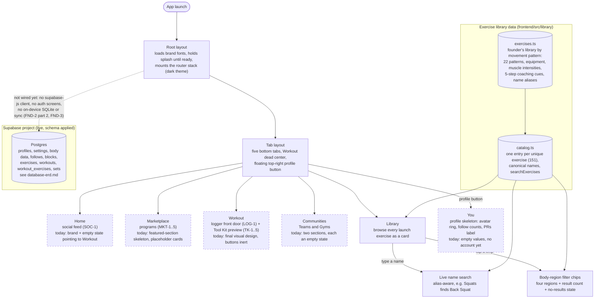

# Astra app — how it works

The living picture of the Expo app: every screen, what the user can do on it, and the path data
takes. Every commit that adds or changes a screen, user action, module or data path updates this
file in the same commit. It draws what exists in code today; scaffolding (placeholder screens,
services not yet wired) is marked so nobody mistakes a mock-up for a working feature.

Legend: solid boxes are working features; dashed boxes are placeholder screens whose layout is
final but whose actions do nothing yet; the dotted link is a connection that does not exist yet.

## What a user can do today

1. Open the app and move between the five tabs and the You screen.
2. On Library, scroll every launch exercise, search by name (aliases included) and filter by body
   region. Nothing is written anywhere; the catalog is bundled, read-only seed data.
3. Everything else is a placeholder that renders its final layout with inert controls.

## Data path today

All data is on the device and read-only: the Library tab reads the bundled catalog, which is built
from the bundled seed module. No network calls are made. The Supabase project exists with its
schema applied and row-level security verified, but the app has no client for it yet.

## Shared pieces every screen uses

- `components/Screen.tsx` and `components/AppBackground.tsx` wrap each tab in the common chrome.
- `components/AstraTabBar.tsx` defines the five tabs once (route, label, icon) and renders the bar.
- `components/ProfileButton.tsx` is the floating route to You.
- `components/ui/` holds Button, Card, EmptyState and Text, styled from `theme/tokens.ts`.
