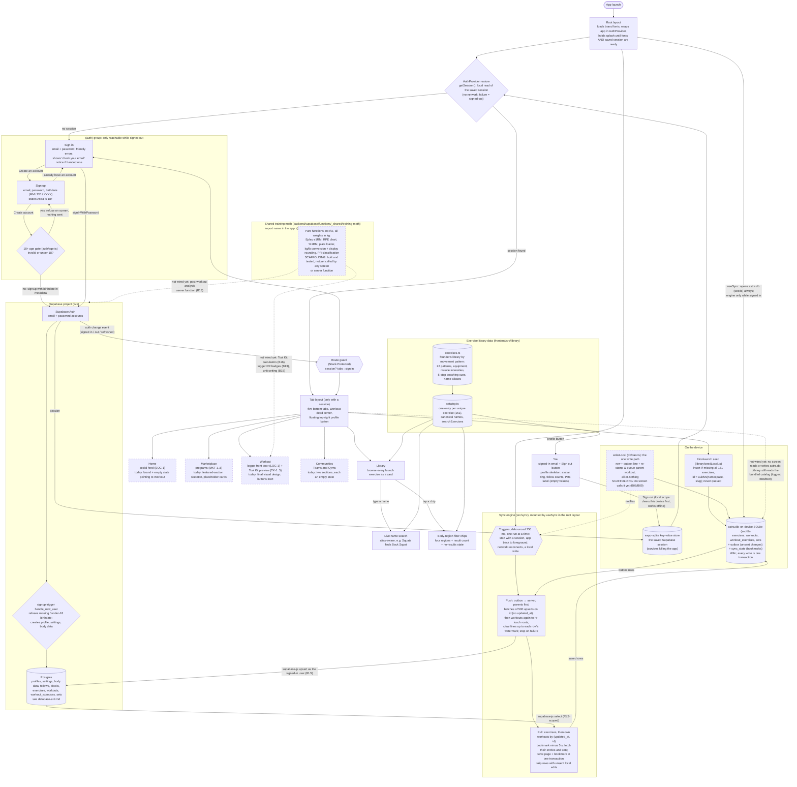

# Astra app — how it works

The living picture of the Expo app: every screen, what the user can do on it, and the path data
takes. Every commit that adds or changes a screen, user action, module or data path updates this
file in the same commit. It draws what exists in code today; scaffolding (placeholder screens,
services not yet wired) is marked so nobody mistakes a mock-up for a working feature.

Legend: solid boxes are working features; dashed boxes are placeholder screens whose layout is
final but whose actions do nothing yet; the dotted link is a connection that does not exist yet.

## What a user can do today

1. **Create an account** with email, password and birthdate. An invalid or under-18 birthdate is
   refused on the spot with "Astra is 18+. You must be 18 or older to create an account." and
   nothing is sent. The database trigger repeats the check for anyone calling the API directly,
   once its migration is applied live (see `database-erd.md`).
2. **Sign in** with email and password. Wrong credentials, a taken email, rate limits and no signal
   each get a plain-language message.
3. **Stay signed in.** Killing and reopening the app restores the saved session from the device
   with no network, straight into the tabs.
4. **Sign out** from the You screen. The guard returns the user to sign-in.
5. Move between the five tabs and the You screen. On Library, scroll, search and filter every
   launch exercise from the bundled, read-only catalog.
6. Everything else is a placeholder that renders its final layout with inert controls.

## Data path today

- **Accounts:** `src/lib/supabase.ts` builds the one supabase-js client from
  `EXPO_PUBLIC_SUPABASE_URL` / `EXPO_PUBLIC_SUPABASE_ANON_KEY` in `frontend/.env` (template:
  `.env.example`). If either is missing it throws a message naming it, and the root
  `ErrorBoundary` hides the splash so that message shows. The session is saved in expo-sqlite's
  key-value store (`expo-sqlite/kv-store`, the app's one storage engine). The access token
  refreshes only while the app is in the foreground (AppState listener).
- `src/auth/AuthProvider.tsx` owns auth state (`restoring` / `signedIn` / `signedOut`) and the
  sign-in, sign-up and sign-out actions. Screens call `useAuth()` and never touch Supabase
  directly. The route guard, not the screens, does all signed-in/out navigation.
- Sign-up sends the checked birthdate as user metadata. The signup trigger stores it in
  `user_body_data` (owner-only under RLS) alongside the new profile and settings rows.
- **On-device store and sync (B07; the engine is live, but no screen uses it yet).**
  `src/sync/useSync.ts` runs in the root layout. On launch it opens `astra.db`
  (`src/db/database.ts`: foreign keys on, WAL, migrations by `PRAGMA user_version`). It then seeds
  the 151 library exercises if they are missing, under the same uuidv5 ids as the server
  (`src/library/uuidv5.ts`, the repo's one implementation, which the seed generator imports).
  While someone is signed in, a `SyncEngine` pushes and then pulls on start, on foreground, on
  reconnect (expo-network) and after each local write.
  - **Writes:** every user change must go through `writeLocal`. It saves the row, adds an outbox
    line, and re-stamps and queues the parent workout, all in one transaction.
  - **Push:** sends the queued rows' current state as upserts on `id`, parents first, with
    `updated_at` left for the server to stamp. It then re-sends the parent workouts so the server
    stamps them after their contents. Outbox lines are cleared only up to the watermark read
    before sending, so an edit made mid-upload is kept for the next push. A retry can't
    duplicate anything, because the id is the key.
  - **Pull:** fetches the user's own workouts changed after the stored `(updated_at, id)`
    bookmark (rewound 5 s), plus every entry and set inside them. It also fetches exercises,
    scoped by RLS. Each page is saved with its bookmark in one transaction. A row with an unsent
    local edit is never overwritten.
  - **Failures:** they are logged, and whatever didn't upload stays queued. There is no retry
    timer.
- **Still unwired:** the Library reads the bundled catalog, not `astra.db`; no screen logs a
  workout yet (B08/B09); nothing feeds the social feed.

## Shared pieces every screen uses

- `components/Screen.tsx` and `components/AppBackground.tsx` wrap each screen in the common chrome.
- `components/AstraTabBar.tsx` defines the five tabs once (route, label, icon) and renders the bar.
- `components/ProfileButton.tsx` is the floating route to You.
- `components/ui/` holds Button, Card, EmptyState, Text, TextField (labeled input) and FormError
  (red alert line), all styled from `theme/tokens.ts`.
- `components/auth/` holds SignInForm, SignUpForm, BirthdateInput and their shared layout styles.
  The route files in `app/(auth)/` only wire them to the router.
- **Training math** (`backend/supabase/functions/_shared/training-math/`, imported in the app as
  `@training-math`) is the only place e1RM, RPE and %1RM working weights, plate breakdowns, kg/lb
  conversion and PR detection are computed. It lives beside the server functions so Supabase can
  bundle it; `frontend/metro.config.js`, `tsconfig.json` and `jest.config.js` map the alias.
  Weights go in and come out in kg (the plate loader alone works in the rack's own unit); rounded
  display numbers are never stored. Nothing calls it yet — it is scaffolding for the calculators,
  logger and analysis.
- Test-only helpers live in `src/test-utils/`: a fake Supabase auth client and fake AppState,
  `renderWithAuth`, a real-SQLite driver over Node's `node:sqlite` (`nodeSqliteDriver.ts`), an
  in-memory fake server for sync (`fakeTransport.ts`: upsert-by-id, server-stamped `updated_at`,
  foreign-key refusals, offline and lost-reply modes), and workout fixtures. The app never
  imports them.
