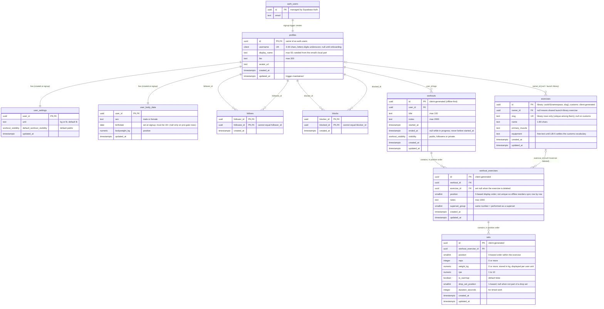

# Astra database — entity relationship diagram

The living picture of the Supabase (Postgres) schema. Every commit that adds or changes a
migration updates this file in the same commit, so it always matches `backend/supabase/migrations/`.
Read it top to bottom: the diagram shows the tables and how they connect; the notes below it cover
the rules a diagram cannot draw (who can see what, what happens automatically, what cascades).

Source migrations: `20261114100000_identity.sql`, `20261114100100_training.sql`,
`20261114110000_fix_exercise_delete.sql`, `20261114120000_exercises_slug.sql`,
`20261114120100_library_seed.sql` (generated — see below), `20261114130000_signup_birthdate_gate.sql`
(**in the repo but not yet applied to the live project** as of the B05 build. The build session
could not reach the Supabase MCP. Until it is applied, live signup does not enforce 18+ and does
not stamp the birthdate).

## The launch library inside `exercises`

The 151 shared launch exercises are rows with `owner_id` null, seeded by the generated migration
`20261114120100_library_seed.sql` — written by `automation/scripts/generate-library-seed.ts` from
`frontend/src/library/catalog.ts`, the library's one home; never edited by hand. Identity contract:
each library row's `id` is `uuidv5(LIBRARY_EXERCISE_NAMESPACE, slug)` (namespace constant exported
by `catalog.ts`), so the phone derives the same id offline without a sync round-trip. A check
constraint makes `slug` mandatory on library rows and forbidden on customs, and a partial unique
index (`slug` where `owner_id is null`) makes re-seeding idempotent. Seeds only upsert: a slug
leaving the catalog never deletes or re-identifies a row (renames are a deliberate content
migration, because workout history references these ids).

## Enums

- `workout_visibility`: `public` (any signed-in user), `followers` (people who follow the owner),
  `private` (owner only). Used by `workouts.visibility` and as the per-user default in
  `user_settings`.

## What happens automatically (triggers)

- **Signup creates the identity rows — and enforces 18+.** Inserting into `auth.users` fires
  `handle_new_user` (migration `20261114130000_signup_birthdate_gate.sql`). It first reads
  `birthdate` (`YYYY-MM-DD`) from the signup's user metadata (`raw_user_meta_data`) and **refuses
  the signup** (raises, rolling the whole account creation back) if it is missing, not a real date,
  or later than `current_date - 18 years`. Otherwise it inserts a `profiles` row (display name taken
  from the email, before the `@`), a default `user_settings` row and a `user_body_data` row with
  `birthdate` stamped, all in the same transaction. An account can never exist without its profile
  or without an 18+ birthdate on record. Every creation path, admin/dashboard and probe scripts
  included, must send `birthdate` in user metadata. That metadata copy is transport only. Age is
  always read from `user_body_data.birthdate`.
- **Birthdates stay 18+ after signup.** The check constraint `user_body_data_birthdate_18_plus`
  (`birthdate is null or birthdate <= current_date - 18 years`) stops a later edit from setting an
  under-18 or future date.
- **Blocking severs follows.** Inserting a `blocks` row fires `handle_new_block`, which deletes any
  `follows` row between the two people in either direction.
- **`updated_at` is maintained** by a trigger on every table that has the column.

## Who can see and change what (row-level security)

All tables have RLS on. "You" means the signed-in user (`auth.uid()`).

| Table | Read | Write |
| --- | --- | --- |
| `profiles` | any signed-in user | only your own row (update) |
| `user_settings`, `user_body_data` | only your own row | only your own row |
| `follows` | rows you are part of | follow as yourself; remove follows you are part of |
| `blocks` | only rows where you are the blocker | manage your own block list |
| `exercises` | launch library (`owner_id` null) plus your own | create, update, delete only your own |
| `workouts` | per the visibility rule below | insert, update, delete only your own |
| `workout_exercises`, `sets` | visible when their workout is | only the workout's owner |

**Workout visibility rule** (`private.workout_visible`): you always see your own; a block in either
direction hides everything; otherwise `public` is open to any signed-in user, `followers` requires
that you follow the owner, `private` is owner-only. Child tables ask the same question through the
workout they belong to. These checks run as `security definer` helpers in the `private` schema so
they can see rows the caller's own RLS would hide.

## Deletion behaviour

- Deleting an auth user cascades through `profiles` to settings, body data, follows, blocks, owned
  exercises, workouts, their entries and sets.
- Deleting a workout cascades to its `workout_exercises` and their `sets`.
- Deleting an exercise keeps the history: `workout_exercises.exercise_id` becomes null rather than
  deleting the logged work.

## Why client-generated primary keys

`workouts`, `workout_exercises` and `sets` get their UUIDs on the device, so a workout logged with
no signal is complete and internally linked before it ever reaches the server. Sync then inserts
the rows as they are, with no id remapping.

## The device mirror (not part of this database)

This diagram draws the server. The phone keeps its own SQLite copy (`frontend/src/db/schema.ts`)
of `exercises`, `workouts`, `workout_exercises` and `sets`. It has the same column names, but
uses text for uuids and timestamps and 0/1 for booleans, and it does not repeat the server's
CHECK rules. It also has two tables of its own: `outbox`, the local changes waiting to upload,
and `sync_state`, the download bookmarks. What this means for the server:

- **Uploads are upserts on `id`** (`INSERT … ON CONFLICT (id) DO UPDATE` through PostgREST), run
  as the signed-in user, so the RLS rules above decide what is accepted. A retried upload updates
  the same row and never duplicates it.
- **Uploads never send `updated_at`.** The column default stamps it on insert and the
  `moddatetime` trigger stamps it on update, so it is always server time. That lets devices
  download "changed since my bookmark" by `(updated_at, id)` without trusting phone clocks.
- **A workout's `updated_at` moves whenever anything inside it changes.** The app re-sends the
  parent workout after its entries or sets land (touch-the-root), so other devices find changed
  entries and sets by watching `workouts` alone.
- Library rows (`owner_id` null) only ever flow server → device; the device seeds its own copy
  with the same uuidv5 ids at first launch.
