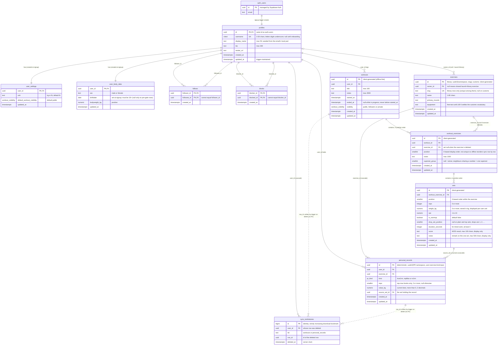

# Astra database — entity relationship diagram

The living picture of the Supabase (Postgres) schema. Every commit that adds or changes a
migration updates this file in the same commit, so it always matches `backend/supabase/migrations/`.
Read it top to bottom: the diagram shows the tables and how they connect; the notes below it cover
the rules a diagram cannot draw (who can see what, what happens automatically, what cascades).

Source migrations: `20261114100000_identity.sql`, `20261114100100_training.sql`,
`20261114110000_fix_exercise_delete.sql`, `20261114120000_exercises_slug.sql`,
`20261114120100_library_seed.sql` (generated — see below), `20261115024010_sets_score.sql`,
`20261115031049_sets_notes.sql`, `20261115035806_personal_records.sql`,
`20261115045638_sync_tombstones.sql` (B14, applied live), `20261114224613_signup_birthdate_gate.sql`
(**in the repo but not yet applied to the live project** as of the B05 build. The build session
could not reach the Supabase MCP. Until it is applied, live signup does not enforce 18+ and does
not stamp the birthdate).

## The launch library inside `exercises`

The 151 shared launch exercises are rows with `owner_id` null, seeded by the generated migration
`20261114120100_library_seed.sql` — written by `automation/scripts/generate-library-seed.ts` from
`frontend/src/library/catalog.ts`, the library's one home; never edited by hand. Identity contract:
each library row's `id` is `uuidv5(LIBRARY_EXERCISE_NAMESPACE, slug)` (namespace constant exported
by `catalog.ts`), so the phone derives the same id offline without a sync round-trip. A check
constraint makes `slug` mandatory on library rows and forbidden on customs, and a partial unique
index (`slug` where `owner_id is null`) makes re-seeding idempotent. Seeds only upsert: a slug
leaving the catalog never deletes or re-identifies a row (renames are a deliberate content
migration, because workout history references these ids).

## Supersets, drop sets and timed / WOD work (B11)

- **Superset** (`workout_exercises.superset_group`): exercises of one workout that sit next to
  each other (by `position`) and share a number are one superset; null means the exercise stands
  alone. The number has no meaning beyond "same group" and no CHECK on the server (the app keeps it
  1…32767). The app only writes it through two operations (link with the exercise above / unlink),
  which first rewrite the numbers to match what is shown, so a group never has one member.
  Reordering does not rewrite groups; a member moved away from its neighbours just shows alone.
- **Drop set** (`sets.drop_set_position`): saved as separate `sets` rows. The top set is null, each
  drop after it is 1, 2, … (CHECK ≥ 1). Displays group a set with the one before it when its drop
  number is higher than that set's (null counts as 0), so a drop set reads as one set.
- **Timed or scored work**: `sets.duration_seconds` (CHECK ≥ 0) holds a time; `sets.score` (added
  by `20261115024010_sets_score.sql`; CHECK
  `char_length(score) <= 100`) holds free text such as "7 rounds + 12 reps". Either can sit
  alongside reps and weight, or stand alone. Nothing parses `score`; timed or scored sets without
  reps and weight add no volume and set no PRs.

## Notes at three levels (B12)

Free text written by the lifter, for people to read; nothing parses it and analysis ignores it.
Each level has its own column and cap (all `char_length` CHECKs, so an emoji counts once):
`workouts.notes` ≤ 2000 and `workouts.title` ≤ 100 (both since the training migration),
`workout_exercises.notes` ≤ 1000 (same), and `sets.notes` ≤ 500 (added by
`20261115031049_sets_notes.sql`). The phone checks the same caps before saving (`@training-math`
`limits.ts`). Notes need no RLS of their own: they are columns on rows the policies below already
cover, so a note is visible to exactly whoever may see its workout.

## Personal records (B13)

`personal_records` (migration `20261115035806_personal_records.sql`) holds **one row per record
book**: user × exercise × kind, plus the rep count for rep maxes. It stores the current best and the
set that proves it. It is not a log of every PR ever hit. The three kinds:

- `true1rm`: the heaviest single.
- `repMax`: the heaviest weight for exactly `reps` reps, one book per rep count.
- `e1rm`: the best Epley estimate from any set.

Volume is never a record. A CHECK ties `reps` to `repMax` (set exactly when the kind is
`repMax`), and a unique index on (user, exercise, kind, `coalesce(reps, 0)`) allows only one row
per book.

- **The phone writes it.** At finish the app folds the full local history of each exercise in the
  workout through `@training-math` (`recordBooks`) and writes only books that **improved**, in the
  same transaction as the workout. The row ids are deterministic per book, so two devices that
  improve the same book offline upsert one row (the last write wins) instead of colliding.
- **Keep-best trigger** (`keep_best_record` → `private.keep_best_personal_record`, runs before
  `set_updated_at`): if an update would **lower** `value_kg`, it keeps the stored value,
  `source_set_id`, `kind`, `reps` and `exercise_id`, and lets the update succeed. It never raises.
  The row still gets a fresh `updated_at`, so the next download repairs the device. This covers a
  fresh device that finishes a lighter set before its first pull. A tie is not "lower", so it
  replaces the source set (the value stays the same; settled in B14 as last-write-wins).
- **Legitimate lowering (B14) goes around the trigger, not through it.** When an edit or delete
  of a past workout lowers a book, the phone uploads it as **delete, then insert** of the same
  row id. The trigger is `BEFORE UPDATE` only, so it never sees that; a plain lowered update
  (a stale device) is still kept at the best. Raises stay plain updates, so keep-best still
  arbitrates them against another device's higher record. The trigger itself is unchanged.
- **Cascades**: deleting the source set, or the exercise, deletes the record row.

## Tombstones (B14)

`sync_tombstones` (migration `20261115045638_sync_tombstones.sql`) is the list of rows that
stopped existing, so a user's other devices can delete their copies (a download cannot see an
absent row). One line per deleted **workout** or **personal record**, written by the
`record_tombstone` trigger — `AFTER DELETE … FOR EACH ROW` on both tables, so rows removed by a
cascade (a deleted workout's records, via its sets) are recorded too. Deleted entries and sets get
no tombstone: their workout is re-stamped, and other devices re-download the whole workout and
drop what is missing. Devices read "tombstones after id N" by the `bigint` identity. The trigger
(`private.record_tombstone`, `security definer`) skips users whose profile is already gone, so
deleting an account is not blocked by the `user_id` foreign key. Retention is unbounded for now.

## Enums

- `workout_visibility`: `public` (any signed-in user), `followers` (people who follow the owner),
  `private` (owner only). Used by `workouts.visibility` and as the per-user default in
  `user_settings`.
- `pr_kind`: `true1rm`, `repMax`, `e1rm`. These are exactly the app's `PrKind` names in
  `@training-math`. Used by `personal_records.kind`.

## What happens automatically (triggers)

- **Signup creates the identity rows — and enforces 18+.** Inserting into `auth.users` fires
  `handle_new_user` (migration `20261114224613_signup_birthdate_gate.sql`). It first reads
  `birthdate` (`YYYY-MM-DD`) from the signup's user metadata (`raw_user_meta_data`) and **refuses
  the signup** (raises, rolling the whole account creation back) if it is missing, not a real date,
  or later than `current_date - 18 years`. Otherwise it inserts a `profiles` row (display name taken
  from the email, before the `@`), a default `user_settings` row and a `user_body_data` row with
  `birthdate` stamped, all in the same transaction. An account can never exist without its profile
  or without an 18+ birthdate on record. Every creation path, admin/dashboard and probe scripts
  included, must send `birthdate` in user metadata. That metadata copy is transport only. Age is
  always read from `user_body_data.birthdate`.
- **Birthdates stay 18+ after signup.** The check constraint `user_body_data_birthdate_18_plus`
  (`birthdate is null or birthdate <= current_date - 18 years`) stops a later edit from setting an
  under-18 or future date.
- **Blocking severs follows.** Inserting a `blocks` row fires `handle_new_block`, which deletes any
  `follows` row between the two people in either direction.
- **`updated_at` is maintained** by a trigger on every table that has the column.
- **Deletes leave tombstones.** Deleting a `workouts` or `personal_records` row (directly or by
  cascade) inserts a `sync_tombstones` line (see Tombstones above).

## Who can see and change what (row-level security)

All tables have RLS on. "You" means the signed-in user (`auth.uid()`).

| Table | Read | Write |
| --- | --- | --- |
| `profiles` | any signed-in user | only your own row (update) |
| `user_settings`, `user_body_data` | only your own row | only your own row |
| `follows` | rows you are part of | follow as yourself; remove follows you are part of |
| `blocks` | only rows where you are the blocker | manage your own block list |
| `exercises` | launch library (`owner_id` null) plus your own | create, update, delete only your own |
| `workouts` | per the visibility rule below | insert, update, delete only your own |
| `workout_exercises`, `sets` | visible when their workout is | only the workout's owner |
| `personal_records` | only your own (B25 will widen this for public profiles) | only your own, and `source_set_id` must be a set in one of your workouts (`private.owns_set`) |
| `sync_tombstones` | only your own | nobody — only the `record_tombstone` trigger inserts |

**Workout visibility rule** (`private.workout_visible`): you always see your own; a block in either
direction hides everything; otherwise `public` is open to any signed-in user, `followers` requires
that you follow the owner, `private` is owner-only. Child tables ask the same question through the
workout they belong to. These checks run as `security definer` helpers in the `private` schema so
they can see rows the caller's own RLS would hide.

## Deletion behaviour

- Deleting an auth user cascades through `profiles` to settings, body data, follows, blocks, owned
  exercises, workouts, their entries and sets, and the user's tombstones.
- Deleting a workout cascades to its `workout_exercises` and their `sets` (and the records citing
  them), and leaves tombstones for the workout and each record. The app deletes a finished
  workout (B14) by sending only the workout's delete; these cascades do the rest.
- Deleting an exercise keeps the history: `workout_exercises.exercise_id` becomes null rather than
  deleting the logged work. Its `personal_records` rows are deleted.
- Deleting a set (or the workout holding it) deletes any `personal_records` row that cites it.

## Why client-generated primary keys

`workouts`, `workout_exercises` and `sets` get their UUIDs on the device, so a workout logged with
no signal is complete and internally linked before it ever reaches the server. Sync then inserts
the rows as they are, with no id remapping.

## The device mirror (not part of this database)

This diagram draws the server. The phone keeps its own SQLite copy (`frontend/src/db/schema.ts`)
of `exercises`, `workouts`, `workout_exercises`, `sets` and `personal_records` (schema version 5
since B14: version 2 (B11) added `sets.score`, version 3 added `sets.notes`, version 4 added
`personal_records`, version 5 added `outbox.op` (`upsert` or `delete`); versions are append-only,
upgraded on launch). There is no device copy of `sync_tombstones` — tombstones are applied as
they download, and `sync_state` keeps the last applied id (`pull_cursor:tombstones`). It has the same column names, but
uses text for uuids and timestamps and 0/1 for booleans, and it does not repeat the server's
CHECK rules as SQL (instead the app checks every set against them before saving, through the
shared `@training-math` `limits.ts`). It also has two tables of its own: `outbox`, the local changes waiting to upload,
and `sync_state`, the download bookmarks. What this means for the server:

- **Uploads are upserts on `id`** (`INSERT … ON CONFLICT (id) DO UPDATE` through PostgREST), run
  as the signed-in user, so the RLS rules above decide what is accepted. A retried upload updates
  the same row and never duplicates it.
- **Uploads never send `updated_at`.** The column default stamps it on insert and the
  `moddatetime` trigger stamps it on update, so it is always server time. That lets devices
  download "changed since my bookmark" by `(updated_at, id)` without trusting phone clocks.
- **A workout's `updated_at` moves whenever anything inside it changes.** The app re-sends the
  parent workout after its entries or sets land (touch-the-root), so other devices find changed
  entries and sets by watching `workouts` alone.
- Library rows (`owner_id` null) only ever flow server → device; the device seeds its own copy
  with the same uuidv5 ids at first launch.
- **The server only ever receives finished workouts.** A workout in progress (`ended_at` null)
  lives only in the device mirror and is never queued; finishing it stamps `ended_at` and queues
  the workout with all its entries and sets in one transaction (B08 active-workout store). So
  every workout the app uploads has an `ended_at`, though the column stays nullable.
- **Weights and RPE arrive already rounded** to their column's decimals (`weight_kg` 2, `rpe` 1,
  `personal_records.value_kg` 3), so the server's numeric rounding changes nothing and a download
  matches the device exactly.
- **Personal records upload after sets** (they cite them) and download on their own bookmark
  (`pull_cursor:personal_records`), after the workout trees. A record row has no parent workout, so
  it does not touch the root.
- **Deletes (B14) are `DELETE … WHERE id IN (…)`** as the signed-in user, sent before any upload
  in each sync, children's tables first. Deleting an id the server no longer has is a no-op, so
  retries are safe.
